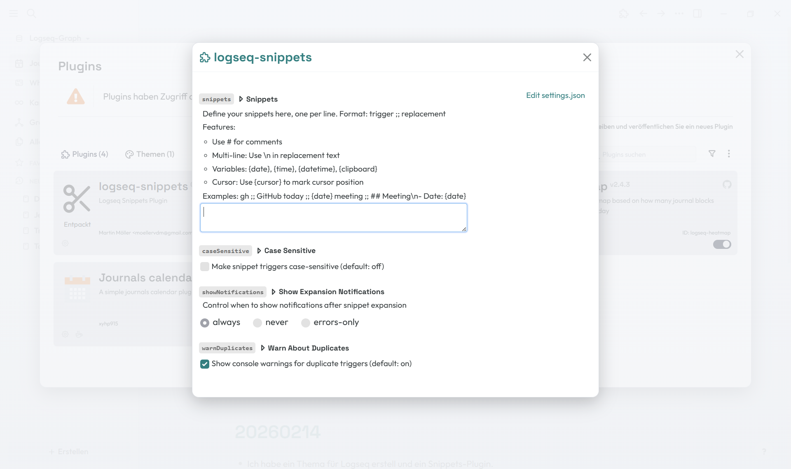

# Logseq Snippets

A powerful text expansion plugin for Logseq with dynamic variables, multi-line support, and smart features.


## ✨ Features

### ⚡ Smart Text Expansion

- **Instant expansion**: Type a trigger followed by space, punctuation, or Enter
- **Word boundaries**: Smart detection prevents false triggers
- **Context-aware**: Never expands inside code, URLs, `[[page refs]]`, `((block refs))` or `{{macros}}`
- **Instant undo**: Press Backspace right after an expansion to get your trigger back (Ctrl+Z works too)
- **Case sensitivity**: Optional case-sensitive or case-insensitive matching

### 📝 Advanced Snippet Capabilities

- **Multi-line snippets**: Use `\n` to create complex templates
- **Dynamic variables**: Insert `{date}`, `{time}`, `{datetime}`, `{clipboard}`
- **Cursor positioning**: Use `{cursor}` to place the caret exactly where you want it
- **Mid-line expansion**: Triggers expand at the caret, not just at the end of a block
- **Comments**: Organize snippets with `#` prefix (raw settings editor)

### 🎨 Customization

- **Snippet Manager**: Search, add, edit and delete snippets in a modern dialog (light & dark theme)
- **Import/Export**: Append or replace from a file, export with one click
- **Configurable notifications**: Choose always / never / errors-only
- **Duplicate detection**: Conflicting triggers are highlighted in the manager
- **Performance optimized**: Smart caching for instant expansion

## 📦 Installation

### Via Logseq Marketplace (Recommended)

1. Open Logseq
2. Go to `Settings` → `Plugins` → `Marketplace`
3. Search for "Logseq Snippets"
4. Click `Install`
5. Open the Snippet Manager via the ✂️ toolbar icon or the command palette (`Snippets: Manage snippets`)

### Manual Installation

1. Download the latest release from the [Releases page](https://github.com/martinmoeller/logseq-snippets/releases)
2. Extract the zip file
3. In Logseq, go to `Settings` → `Plugins`
4. Enable `Developer Mode`
5. Click `Load unpacked plugin`
6. Select the extracted folder

## 🚀 Quick Start

### Basic Snippets

1. Click the ✂️ toolbar icon (or run `Snippets: Manage snippets` from the command palette)
2. Click **New**, enter a trigger and the replacement text – changes are saved automatically
3. Type the trigger followed by space, punctuation, or Enter

Prefer plain text? The raw `trigger ;; replacement` format is still editable in `Settings` → `Plugin Settings` → `Logseq Snippets`.

**Examples:**
```
gh ;; GitHub
gm ;; Good Morning
email ;; your.email@example.com
```

### Dynamic Variables

Use variables to insert current information:

```
today ;; {date}
now ;; {datetime}
paste ;; {clipboard}
```

**Available Variables:**
- `{date}` → Current date (2026-02-15)
- `{time}` → Current time (14:30)
- `{datetime}` → Date and time (2026-02-15 14:30)
- `{clipboard}` → Clipboard content

### Multi-line Templates

Create complex templates with `\n`:

```
meeting ;; ## Meeting Notes\n- Date: {date}\n- Attendees: \n- Topics:
standup ;; ## Daily Standup\n\n### Yesterday\n- \n\n### Today\n- \n\n### Blockers\n- None
```

### Cursor Positioning

Use `{cursor}` to mark where the cursor should be after expansion:

```
link ;; [text]({cursor})
code ;; ```\n{cursor}\n```
note ;; > **Note**: {cursor}
```

## ⚙️ Settings

| Setting | Description | Default |
|---------|-------------|---------|
| **Expand On** | Keys that expand a trigger: Space, punctuation (`, . ;`), Tab | Space, punctuation |
| **Enter Key** | *Expand only*, *Expand and create a new block*, or *Never expand on Enter* | Expand only |
| **Trigger Prefix** | Only expand triggers typed with this prefix, e.g. `;` → `;gh` | Off (empty) |
| **Case Sensitive** | Only expand triggers typed with exactly the same case | Off |
| **Match Capitalisation** | `Gm` → first letter capitalised, `GM` → ALL CAPS (only when case-insensitive) | Off |
| **Show Expansion Notifications** | Always / Errors-only / Never | Errors-only |
| **Snippets (Raw Text)** | Plain-text version of the Snippet Manager (`trigger ;; replacement`) | Example snippets |

### Notification Options

- **Always**: Show notifications for both successful expansions and errors
- **Never**: Don't show any notifications (silent mode)
- **Errors-only**: Only show notifications when expansion fails

## 💡 Usage Tips

### Template Snippets

Create reusable templates for common structures:

```
bug ;; ## Bug Report\n- **Date**: {date}\n- **Severity**: \n- **Description**: \n- **Steps to Reproduce**: \n  1. \n- **Expected**: \n- **Actual**:

todo ;; TODO:\n- [ ] Task 1\n- [ ] Task 2\n- [ ] Task 3
```

### Quick Links

```
docs ;; [[Documentation]]
proj ;; [[Projects/Current Sprint]]
@john ;; [[John Doe]]
```

### Code Snippets

```
jsfn ;; function name() {\n  {cursor}\n}
log ;; console.log({cursor})
arrow ;; const name = () => {cursor}
```

### Comment Organization

```
# Personal snippets
email ;; your.email@example.com
phone ;; +1-555-0123

# Work snippets
sig ;; Best regards,\nYour Name\nYour Title
```

## 📸 Screenshot



The screenshot shows the plugin settings panel with example snippets, including multi-line templates, dynamic variables, and various configuration options.

## 🛠️ Development

### Build from Source

```bash
# Clone the repository
git clone https://github.com/martinmoeller/logseq-snippets.git
cd logseq-snippets

# Install dependencies
npm install

# Build the plugin
npm run build

# Development mode
npm run dev
```

### Code Quality

```bash
# Lint code
npm run lint

# Format code
npm run format

# Check formatting
npm run format:check
```

## 🐛 Troubleshooting

**Snippet not expanding?**
- Make sure there's a word boundary before the trigger (space, start of line, etc.)
- Check if case sensitivity is affecting matching
- Verify the trigger doesn't contain typos

**Duplicate trigger badges?**
- Check for triggers that differ only in case when case-sensitivity is off
- The longest matching trigger wins; among equal triggers the first one is used

**Variables not working?**
- `{clipboard}` requires clipboard permissions in your browser
- Make sure variable syntax is exact: `{date}`, not `{Date}` or `{ date }`

## 🤝 Contributing

Contributions, issues, and feature requests are welcome! Feel free to check the [issues page](https://github.com/martinmoeller/logseq-snippets/issues).

## 📝 License

Copyright © 2026 [Martin Möller](mailto:moellervdm@gmail.com)

This project is [MIT](./LICENSE) licensed.

## 💖 Support

If you like this plugin, please consider:
- ⭐ Starring the repository
- 🐛 Reporting bugs
- 💡 Suggesting new features
- 🔀 Contributing improvements

## 🔗 Links

- [Logseq](https://logseq.com/)
- [Report an Issue](https://github.com/martinmoeller/logseq-snippets/issues)
- [View Releases](https://github.com/martinmoeller/logseq-snippets/releases)
- [Changelog](./CHANGELOG.md)

---

Made with 💚 for the Logseq community
